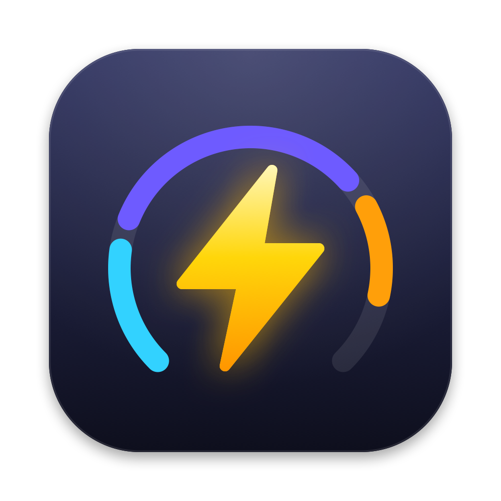
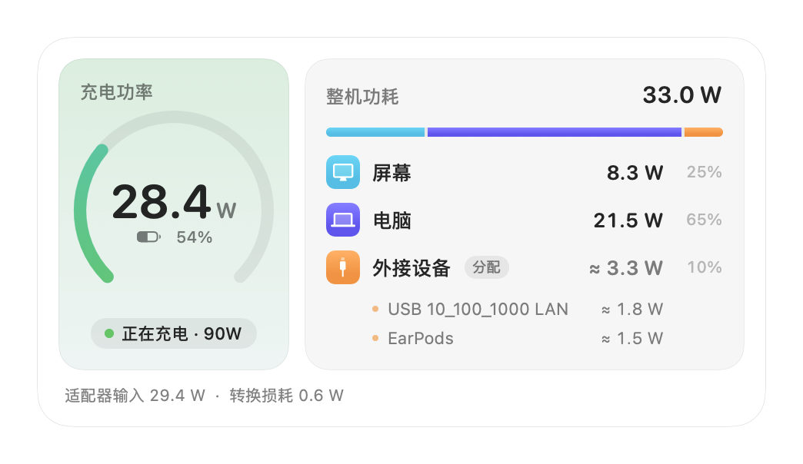
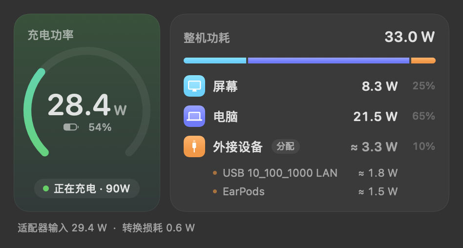

<p align="center">
  
</p>

<h1 align="center">WattBar</h1>

<p align="center">
  一个原生的 macOS 菜单栏功耗监视器：查看充电功率，以及屏幕、电脑本体、外接设备各自消耗了多少电。
</p>

<p align="center">
  
  
</p>

## 功能

- **充电功率**：显示充电或放电功率，圆环表示当前功率占适配器额定功率的比例，同时显示电量和剩余时间。
- **功耗拆分**：整机功耗拆成三部分，各自的功率和占比用彩色条显示。
  - **屏幕**：读取 SMC 背光传感器，是实测值。
  - **电脑**：整机功耗减去屏幕和外接设备。
  - **外接设备**：逐台列出所有从本机取电的设备。
- **数据如实标注**：外接设备的功率来自 USB-PD 协商功率或 USB 分配电流，只是上限，界面上用 `≈` 和“协商”“分配”标签标出，不会冒充实测值。
- **右键设置**：刷新频率（1/2/5 秒）、在菜单栏显示功率、外观（跟随系统、浅色、深色）、登录时启动。
- **轻量**：面板关闭时不轮询，内存占用约 16 MB，单次读取约 1 ms；没有第三方依赖。

## 系统要求

- macOS 14 及以上，Apple Silicon 的 MacBook。
- 屏幕背光功率已在 M1 Pro 上验证；读不到时会显示 `—`，其他数据不受影响。
- 桌面 Mac（没有电池）会显示“此 Mac 不支持”。Intel Mac 没有测试过。
- 编译需要 Xcode 和 Swift 6 工具链。

## 编译与运行

```bash
git clone https://github.com/AvenJi0320/WattBar.git
cd WattBar
swift test                    # 运行单元测试
./scripts/bundle.sh           # 生成 build/WattBar.app（ad-hoc 签名）
open build/WattBar.app
```

想长期使用，可以把 `build/WattBar.app` 拖到「应用程序」，然后右键闪电图标，勾选「登录时启动」。

## 用法

- **左键**点击菜单栏的闪电图标：打开或关闭面板。
- **右键**（或按住 Control 再点击）：打开设置菜单。

菜单栏图标会随电源状态变化：

| 图标 | 状态 |
|---|---|
| `bolt.fill` | 正在充电 |
| `bolt` | 接着电源，但没在充电（已充满或暂停充电） |
| `bolt.slash` | 使用电池 |

## 数据来源

| 指标 | 来源 | 性质 |
|---|---|---|
| 整机功耗 | SMC `PSTR`；读不到时用 `AppleSmartBattery.SystemLoad` | 实测 |
| 适配器输入 | SMC `PDTR` | 实测 |
| 屏幕 | SMC `PDBR`（背光） | 实测 |
| 充电 / 放电 | 电池电压 × 电流 | 实测 |
| 外接设备 | USB-C `PowerOutDetails`（PD 协商功率），或 `UsbPowerSinkAllocation`（USB 分配电流） | 上限估算 |
| 电脑 | 整机 − 屏幕 − 外接设备 | 推算 |

读取 SMC 不需要 root 权限，但 app 不能开启 App Sandbox。

## 隐私

- 不联网，不收集数据，也不上传任何信息。
- 功耗数据只保存在内存里，不写入磁盘。
- 只在 `UserDefaults` 里保存 3 个设置：外观、刷新频率、是否在菜单栏显示数值。

## 开发

```text
Sources/
├─ CSMC/            SMC 的 C 结构体与调用
├─ WattBarCore/     纯逻辑：解析、推导、格式化、调度（可单元测试）
├─ WattBarSystem/   IOKit / SMC 读取、USB 热插拔、电源事件
├─ WattBar/         菜单栏 App（AppKit + SwiftUI）
└─ WattBarProbe/    调试 CLI
```

常用命令：

```bash
swift run wattbar-probe --once      # 打印原始读数和推导结果
swift run wattbar-probe --bench 1000
swift run wattbar-probe --smc-dump P
scripts/capture-fixtures.sh <name>  # 采集测试 fixture（自动脱敏）
scripts/make-icon.sh                # 重新生成 App 图标
```

- 在 Codex 等受限沙箱中，用 `scripts/swiftw.sh build|test` 代替 `swift build|test`。
- 完整的设计与实现规格见 [SPEC.md](SPEC.md)。
